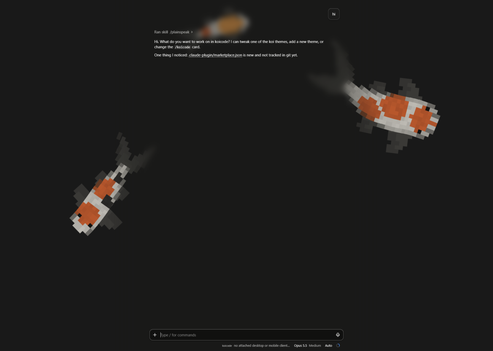
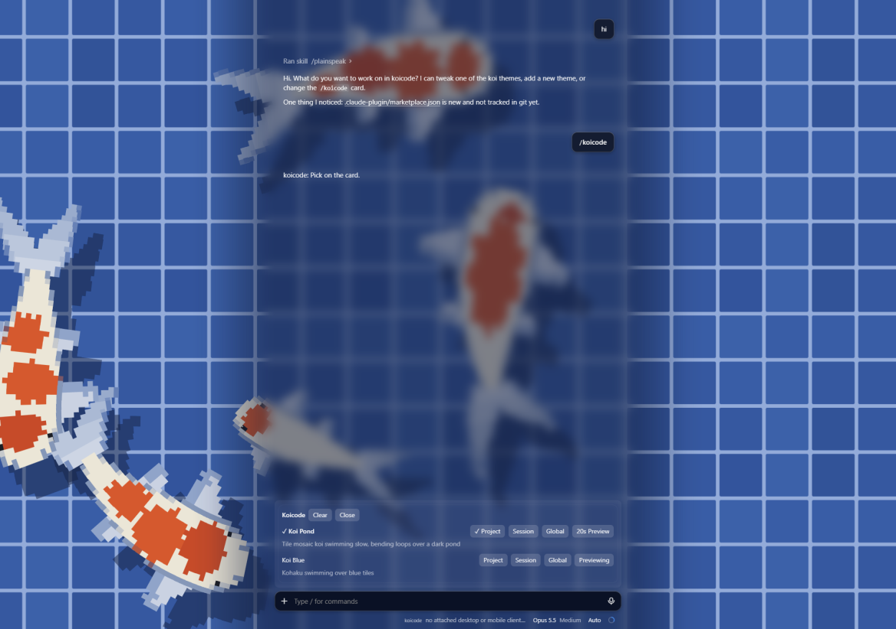

# koicode

A mod for the Claude Code desktop app. It puts animated mosaic koi behind the chat.

## Themes

**Koi Pond**: koi made of colored tiles swim over the app's own background.



**Koi Blue**: red and white koi swim over a floor of blue tiles and cast shadows.



## Install

Add this repo as a marketplace, then install the plugin:

```bash
claude plugin marketplace add aseeon/koicode
claude plugin install koicode@koicode
```

To install from a local clone, pass its path to `marketplace add` instead. Restart the desktop app, or start a new session, so it loads the plugin.

## Use

Run `/koicode` to open the card. For each theme you can apply it to the project, the session or every project, or preview it for 20 seconds. Clear turns the backdrop off.

## Checks

```bash
claude plugin validate .
npx -p typescript tsc -p .
node scripts/check-koi-pond.mts
claude plugin test .
```

## License

Apache-2.0. See `LICENSE`.

## Acknowledgments

The visuals are inspired by [daoho.dev](https://www.daoho.dev/).

The `/koicode` card and theme handling started from Anthropic's `theme-examples` plugin (Apache-2.0).
